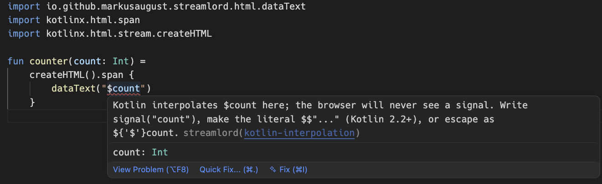

# Streamlord

[](https://central.sonatype.com/namespace/io.github.markusaugust.streamlord)
[](https://marketplace.visualstudio.com/items?itemName=MarkusAugust.streamlord)
[](https://plugins.jetbrains.com/plugin/34587-streamlord)
[](LICENSE)

**Write Datastar safely in Kotlin.**

Streamlord is a [Datastar](https://data-star.dev) toolchain for Kotlin: four tools, designed
together. An SDK for Ktor and Spring, assertions for your tests, an analysis for your CI, and two
editor extensions. Adopt one, or all four.

The official [Datastar Kotlin SDK](https://github.com/starfederation/datastar-kotlin) writes the
protocol's events and leaves the framework, the markup, the tests and the editor to you.
Streamlord writes the same events and brings the rest with it.

Streamlord is Kotlin only. For Java, use
[the official Java SDK](https://github.com/starfederation/datastar-java).

Streamlord is still 0.x: the API can change between minor versions, and
[the changelog](CHANGELOG.md) says what changed and how to move.

## Datastar lives in strings your compiler never reads

Each of these compiles, and without Streamlord you find out in the browser:

| The mistake | What happens | What stops it |
|---|---|---|
| `dataOnClick("$heads++")` with a variable `heads` in scope | Kotlin puts its value in: the browser gets `13++`, and the button does nothing | Your editor, and CI |
| `data-on:submit.prevent="@post('/heads')"` | Datastar waits for an event named `submit.prevent`, which never comes | Your editor, and CI |
| `patchElements(html, mode = ElementPatchMode.APPEND)` with no selector | The browser rejects the event | The SDK, before a byte is sent |
| An event written by hand without `flush()` | It waits in a buffer, on an open stream for minutes | The SDK, on every event |

The first is [the $ trap](https://streamlord-docs.netlify.app/dollar-trap/), and the sections
below follow it through all four tools, on one feed.

## The SDK: build the feed

Adapters for Ktor and Spring, both [Spring MVC](https://streamlord-docs.netlify.app/spring-webmvc/)
and [WebFlux](https://streamlord-docs.netlify.app/spring-webflux/), over one core that imports
no framework. Here is a route that adds a line to a list and updates a counter, first written
by hand against the protocol:

```kotlin sample=ktor-routing
get("/feed") {
    call.response.header("Cache-Control", "no-cache")
    call.response.header("X-Accel-Buffering", "no")
    if (call.request.local.version == "HTTP/1.1") {
        call.response.header("Connection", "keep-alive")
    }
    call.respondBytesWriter(ContentType.Text.EventStream) {
        writeStringUtf8("event: datastar-patch-elements\n")
        writeStringUtf8("data: selector #feed\n")
        writeStringUtf8("data: mode append\n")
        writeStringUtf8("data: elements <li>A new head hangs on the wall</li>\n\n")
        flush()
        writeStringUtf8("event: datastar-patch-signals\n")
        writeStringUtf8("data: signals {\"heads\":13}\n\n")
        flush()
    }
}
```

With Streamlord:

```kotlin sample=ktor-routing
get("/feed") {
    call.respondDatastar {
        patchElements(selector = "#feed", mode = ElementPatchMode.APPEND) {
            li { +"A new head hangs on the wall" }
        }
        patchSignals("heads" to 13)
    }
}
```

Both send the same events. By hand, the flushing, the line splitting, the selector rules, the
JSON and the headers are yours to get right, and
[the introduction](https://streamlord-docs.netlify.app/introduction/) shows what each of them
costs.

## Assertions: test the feed

`streamlord-test` reads a response back into events, so a test says what the endpoint meant
instead of comparing bytes. Here `events` is `datastarEvents(response.bodyAsText())` for the
feed above:

```kotlin sample=assertions
events.assertPatchElements(
    selector = "#feed",
    mode = ElementPatchMode.APPEND,
    containing = "A new head",
)
events.assertSignal("heads", 13)
```

[Testing](https://streamlord-docs.netlify.app/testing/) has the whole test.

## The editors: break it by accident

The page that holds the feed gets a button, and Kotlin takes `$heads` for itself:

```kotlin sample=none
fun FlowContent.wall(heads: Int) {
    ul { id = "feed" }
    button {
        dataOnClick("$heads++")
        +"Hang a head"
    }
}
```

A [VS Code extension](https://marketplace.visualstudio.com/items?itemName=MarkusAugust.streamlord)
and an [IntelliJ IDEA plugin](https://plugins.jetbrains.com/plugin/34587-streamlord) mark it as
you type, with `increment("heads")` one quick fix away. Here is the same trap in VS Code:



They read Datastar as a language in HTML, Kotlin strings and template files: diagnostics with
quick fixes, completion, hover, highlighting that colours only the Datastar tokens, and a Stream
Inspector that shows the events a response sent. They need no part of the Streamlord SDK, so
they work just as well in a project on the official SDK. VS Code checks a template file once an
extension for that engine is installed, since that is what tells VS Code the file's language.
[The editors page](https://streamlord-docs.netlify.app/editors/) has the rest.

## The analysis: CI stops it anyway

`streamlord-analysis` is the editors' check as a library. Ignore the editor, or never open the
file, and one test over your sources still fails the build on `dataOnClick("$heads++")`:

```kotlin sample=test
private val analyzer = Analyzer()

@Test
fun `no source file interpolates a signal into Datastar`() {
    val offenders =
        java.io.File("src/main/kotlin")
            .walkTopDown()
            .filter { it.extension == "kt" }
            .flatMap { file ->
                val source = file.readText()
                analyzer
                    .analyzeKotlin(source)
                    .filter { it.severity == Severity.ERROR }
                    .map { it.format(file.path, source) }
            }.toList()

    assertTrue(offenders.isEmpty(), offenders.joinToString("\n"))
}
```

[The analysis](https://streamlord-docs.netlify.app/analysis/) has the rest, including a check
for signals a handler reads that no page declares.

## Three ways to write markup

Write HTML with the kotlinx.html DSL above, as a Kotlin string, or with a template engine
(Pebble, Thymeleaf, JTE, kte, FreeMarker, Velocity, Mustache).
Every entry point that takes HTML takes a
`String`, so all three are equals, and both editors check Datastar in all three.
[Choosing a style](https://streamlord-docs.netlify.app/choosing-a-style/) helps you pick.

## Install

Most projects take two artifacts: the adapter for your framework, plus `streamlord-html` for the
kotlinx.html DSL. For Ktor:

```kotlin sample=none
dependencies {
    implementation("io.github.markusaugust.streamlord:streamlord-ktor:0.13.0")
    implementation("io.github.markusaugust.streamlord:streamlord-html:0.13.0")
}
```

For Spring Boot 4:

```kotlin sample=none
dependencies {
    implementation("io.github.markusaugust.streamlord:streamlord-spring:0.13.0")
    implementation("io.github.markusaugust.streamlord:streamlord-html:0.13.0")
}
```

The assertions and the analysis are `streamlord-test` and `streamlord-analysis`, both in
`testImplementation`. There are ten modules and you will never want all of them.
[Install and modules](https://streamlord-docs.netlify.app/install/) explains which and why, with
Maven as well as Gradle.

## Documentation

[The documentation](https://streamlord-docs.netlify.app) has the protocol, both adapters, the
security model, the editors and the architecture, as well as
[live views](https://streamlord-docs.netlify.app/live-views/),
[GraalVM native image](https://streamlord-docs.netlify.app/native-image/) and
[Datastar Pro](https://streamlord-docs.netlify.app/datastar-pro/), whose attributes Streamlord
writes without shipping any Pro code. To begin,
[write your first stream](https://streamlord-docs.netlify.app/first-stream/).

What is coming is on [the roadmap](https://streamlord-docs.netlify.app/roadmap/).

## Licence

MIT. Take it, wield it, and may your streams never buffer. Every released version stays MIT, but
the name Streamlord and the mark are not part of the grant: fork freely, under another name.
Issues are always welcome and pull requests start with a conversation; see
[CONTRIBUTING.md](CONTRIBUTING.md) and [the licence page](https://streamlord-docs.netlify.app/licence/).

> *The elders of Bonereach asked Gorvek what a warrior wants of a stream.*
>
> *"That it flows when I say flow. That it stops when I say stop. That it carries my will to
> the far shore, and nothing else."*
>
> *"And the JavaScript?"*
>
> *"I do not know the word."*
>
> Gorvek of Bonereach, who walked out of the Ashfall with iron in his hand

*Gorvek, Sarn, Gallowmark and every other name in this grimoire are our own
invention. Any resemblance to legends told at other tables is the mead's doing.*

---

<a href="https://sobernetics.no">
  <picture>
    <source media="(prefers-color-scheme: dark)" srcset=".github/sobernetics-dark.svg">
    
  </picture>
</a>
